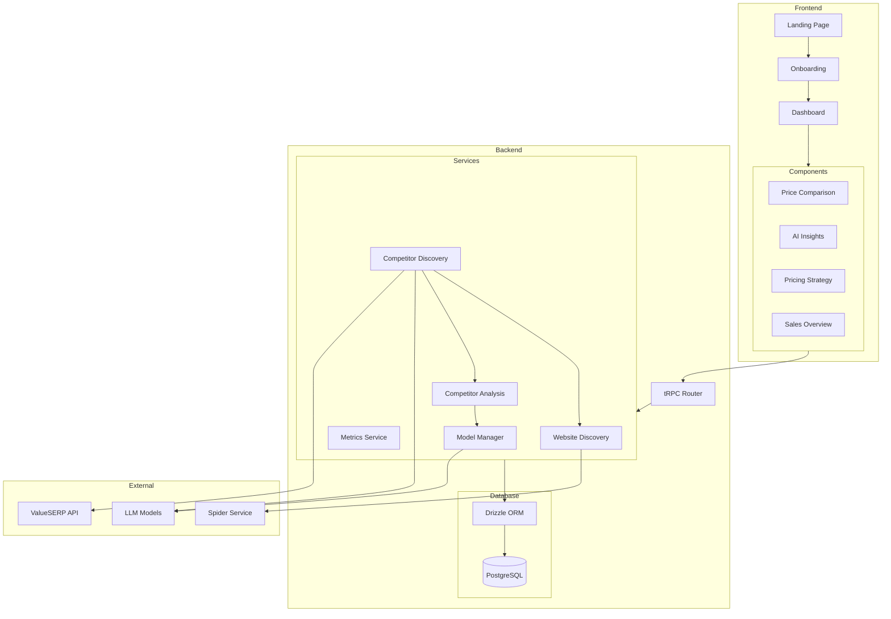

# System Overview

Sagelytics is split into a web app (Next.js/tRPC) and a Nest microservice layer for discovery/analysis workloads.

## Runtime Topology

## Important Integration Notes

- Next.js communicates with microservices through the Nest TCP client (`@nestjs/microservices`).
- Port `3001` is TCP transport, not HTTP.
- Discovery is designed to degrade gracefully when Redis cache/progress paths are unavailable.
